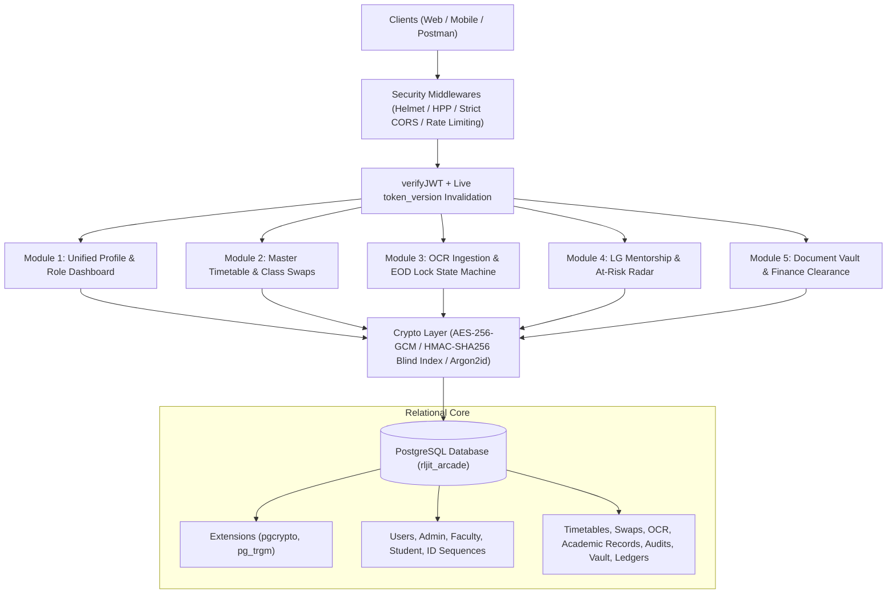
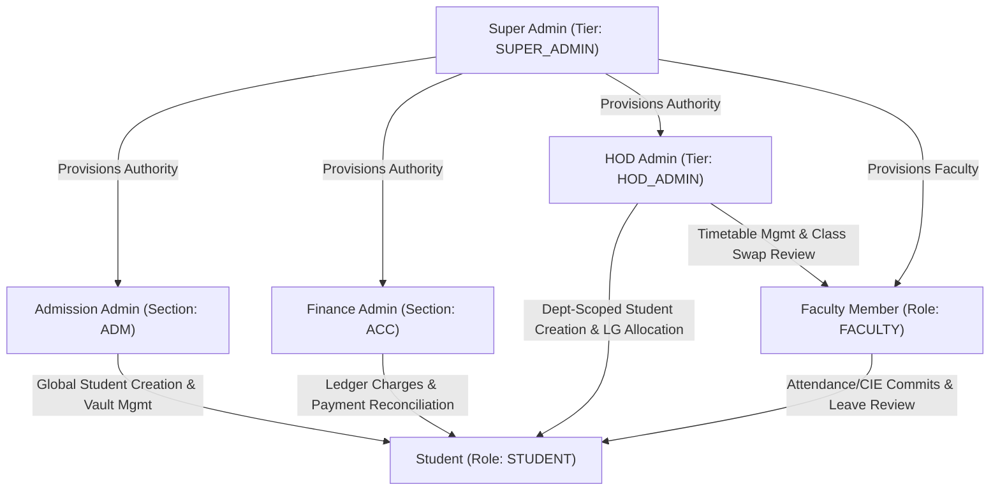

# RLJIT Arcade - Backend Architecture & Technical Manual

> **Modular, High-Performance Institutional ERP & Academic Automation Engine**  
> Built with **Node.js**, **Express 5**, and **PostgreSQL (`pg`)**.

---

## 1. Executive Architecture Overview

**RLJIT Arcade** is an enterprise-grade academic administration backend engineered for higher education institutions. The system replaces disconnected spreadsheets and legacy silos with an event-consistent, cryptographically hardened relational backbone.



---

## 2. Cryptographic & Security Primitives

RLJIT Arcade implements a zero-trust data security pipeline:

| Mechanism | Implementation | Security Objective |
| :--- | :--- | :--- |
| **Password Hashing** | `Argon2id` (v=19, m=65536, t=3, p=4) | State-of-the-art resistance to GPU/ASIC brute-force cracking. |
| **PII Encryption** | `AES-256-GCM` (`iv:authTag:ciphertext`) | Confidentiality & tamper-proofing for names, emails, phone numbers, and WhatsApp contacts. |
| **Exact Search** | `HMAC-SHA256` Blind Indexes (`email_bidx`, `phone_bidx`) | Fast $O(\log N)$ exact search without ever decrypting database columns or storing plaintext. |
| **Fuzzy / USN Search** | PostgreSQL `pg_trgm` GIN Indexing | Sub-millisecond substring and typo-tolerant search over USNs and usernames. |
| **Session Revocation** | `token_version` on `users` table | Instantaneous revocation across all devices on logout without Redis overhead. |
| **Network & Headers** | `helmet`, `hpp`, strict CORS origin matching | Protection against MIME sniffing, parameter pollution, XSS, and unauthorized cross-origin requests. |
| **Upload Guardrails** | `multer` DiskStorage with UUIDs | Strict 5MB limit, whitelist of `.jpg`, `.jpeg`, `.png`, `.pdf` for Vault & OCR sheets. |

---

## 3. Hierarchical RBAC & Authority Model

The platform enforces strict role boundaries and organizational scoping:



### Institutional Role Scopes
1. **Super Admin (`SUPER_ADMIN`):** Unrestricted administrative oversight, system bootstrapping, and secondary Principal-tier unlock approvals.
2. **Admission Admin (`ADMIN`, `sectionCode: 'ADM'`):** Institutional-wide student creation, certificate vault uploads, and physical document verification.
3. **Finance Admin (`ADMIN`, `sectionCode: 'ACC'`):** Fee and fine assessment, offline/online payment logging, and student financial clearance auditing.
4. **HOD Admin (`HOD_ADMIN`, `department: 'DEPT'`):** Department-locked student creation, faculty sub-role assignments (CR, LG Coordinator), master timetable setup, and primary unlock reviews.
5. **Faculty (`FACULTY`):** OCR attendance/CIE grading, class swap requests, mentee guidance, and student leave approvals.
6. **Student (`STUDENT`):** Schedule inspection, fee status tracking, leave applications, and automated hall ticket clearance auditing.

---

## 4. Database Schema Specification

All tables are created atomically and dynamically on initial startup in the PostgreSQL database `rljit_arcade`:

```
rljit_arcade
├── Extensions: pgcrypto, pg_trgm
├── Core Identity & Credentials:
│   ├── id_sequences (prefix VARCHAR PK, last_seq INT)
│   ├── users (UUID PK, username, password_hash, full_name_enc, email_enc, phone_enc, email_bidx, phone_bidx, base_role, admin_tier, token_version...)
│   ├── admin (id SERIAL PK, user_id UUID FK, role_type, section_code, permissions...)
│   ├── faculty (id SERIAL PK, user_id UUID FK, employee_code, department, cabin_room, is_lg_coordinator...)
│   └── student (id SERIAL PK, user_id UUID FK, usn UNIQUE, department, semester, section, admission_quota, cgpa, lg_faculty_id UUID...)
└── Core Domain Modules:
    ├── timetables (id SERIAL PK, department, semester, section, day_of_week, period_no, subject_code, faculty_id UUID, room_no...)
    ├── timetable_swaps (id SERIAL PK, timetable_id INT FK, swap_date DATE, requesting_faculty_id UUID, target_faculty_id UUID, status...)
    ├── ocr_staging_batches (id SERIAL PK, faculty_id UUID, record_type, department, semester, section, image_path, extracted_json, status...)
    ├── academic_records (id SERIAL PK, student_usn, subject_code, department, semester, section, record_type, attendance_status, marks_obtained, locked_after TIMESTAMPTZ, is_unlocked_override BOOL...)
    ├── record_unlock_requests (id SERIAL PK, academic_record_id INT FK, student_usn, requested_by UUID, department, current_val, proposed_val, reason, hod_status, principal_status, is_consumed BOOL...)
    ├── academic_audit_logs (id SERIAL PK, academic_record_id INT FK, unlock_request_id INT FK, executed_by UUID, previous_val, updated_val, reason...)
    ├── lg_leave_requests (id SERIAL PK, student_usn, lg_faculty_id UUID, from_date DATE, to_date DATE, reason, status, parent_notified BOOL...)
    ├── student_documents (id SERIAL PK, student_usn, doc_type, file_path, verification_status, custody_status, verified_by UUID...)
    ├── finance_ledgers (id SERIAL PK, student_usn, category, title, total_amount, paid_amount, due_date DATE, status, imposed_by UUID...)
    └── finance_transactions (id SERIAL PK, ledger_id INT FK, student_usn, amount_paid, payment_mode, ref_no_encrypted, recorded_by UUID...)
```

---

## 5. The 5 Core Modules

### Module 1: Unified Profile & Role Dashboard
* **Dynamic Profile Introspection:** Retrieves decrypted PII, system authorities, role scopes, and contextual associations (e.g., student's assigned Local Guardian, faculty's coordinator status).
* **Role-Tailored KPI Dashboards:** Computes real-time dynamic SQL metrics without mock data:
  * *Students:* Overall attendance percentage, average CIE scores, pending fee dues, hall ticket eligibility.
  * *Faculty:* Mentee count, at-risk alerts, pending leaves, pending class swap requests.
  * *HODs:* Department student enrollment, faculty headcounts, pending post-EOD unlocks, daily class swap status.
  * *Super Admins:* Institution-wide rollups across all departments.

### Module 2: Master Timetable & Class Swap Engine
* **Conflict-Free Schedule Matrix:** Enforces uniqueness per `(department, semester, section, day_of_week, period_no)`.
* **Dynamic Daily Schedule Overlay:** When viewing daily schedules (`GET /timetable/daily-view`), approved swaps for that date dynamically replace the assigned faculty and subject code while maintaining the base schedule intact.

### Module 3: OCR Attendance/CIE, EOD Hard Lock & Dual-Approval Unlock
* **OCR Ingestion & Draft Extraction:** Ingests raw handwritten sheets into `uploads/ocr/`, generates structured candidate JSON matched against enrolled students, and awaits faculty review.
* **Automatic EOD Hard Lock:** Committing records sets `locked_after` to the end of the day (`23:59:59.999`). Edits attempted after this window return `423 Locked`.
* **Dual-Approval State Machine:**
  ```mermaid
  stateDiagram-v2
      [*] --> Locked: EOD Expires (23:59:59)
      Locked --> UnlockRequested: Faculty Submits Reason & Proposed Value
      UnlockRequested --> HODApproved: HOD Approves (Dept-Scope Verified)
      HODApproved --> PrincipalApproved: Principal / Super Admin Approves
      PrincipalApproved --> RecordUnlocked: Single-Use Override Enabled
      RecordUnlocked --> AuditLogged: Faculty Consumes Override (Atomic Transaction)
      AuditLogged --> Locked: is_unlocked_override = FALSE
  ```
* **Immutable Audit Trail:** Record modification creates an immutable audit row in `academic_audit_logs` linking the previous value, new value, justification, and approval references.

### Module 4: LG Mentorship, At-Risk Radar & Leave Lifecycle
* **Mentee Mapping & Coordinator Allocation:** HODs bulk-map students to designated faculty mentors and grant institutional sub-roles.
* **Early-Warning At-Risk Radar:** Automatically flags students exhibiting:
  1. Attendance $< 75\%$
  2. Average CIE Marks $< 40\%$ ($< 12 / 30$)
  3. Unpaid tuition fees or disciplinary fines
* **Parent Communication Integration:** LG approval of student leaves triggers automated status updates and WhatsApp gateway dispatch flags.

### Module 5: Document Vault, Finance Ledgers & Automated No-Dues
* **Cryptographic Student Vault:** Stores vital certificates (10th, 12th, Transfer Certificate) in `uploads/vault/`, tracking verification and physical custody (`WITH_STUDENT`, `SUBMITTED_TO_ADMISSION_DEPT`, `RETURNED_TO_STUDENT`).
* **Financial Ledger & Payment Reconciliation:** Manages itemized charges and payments with encrypted banking references (`AES-256-GCM`).
* **Automated 4-Pillar Examination Clearance Engine:**
  Evaluates institutional eligibility for VTU Semester End Examination Hall Tickets:
  $$\text{Clearance} = (\text{Attendance} \ge 85\%) \land (\text{CIE Avg} \ge 40\%) \land (\text{Pending Dues} = 0) \land (\text{Unverified Docs} = 0)$$

---

## 6. API Reference & Postman Integration

The complete Postman testing manual is located in:
👉 [**`postman_uri.md`**](file:///e:/Community_Based_Project_RLJIT_Arcade/rljit_arcade/postman_uri.md)

### Key Endpoints Snapshot

| Method | Endpoint | Description | Auth / Scope |
| :--- | :--- | :--- | :--- |
| `GET` | `/` | Server health check and API catalog | Public |
| `GET` | `/db:rljit_arcade/connect` | Initialize database & all 14 tables | Public Diagnostic |
| `GET` | `/api/v1/db/verify-storage` | 11-table live row count & tuple inspector | Super Admin / Key |
| `POST` | `/api/v1/auth/bootstrap-super-admin` | One-time Super Admin bootstrap | `x-bootstrap-key` |
| `POST` | `/api/v1/super-admin/provision-authority`| Provision Admission Admin, HOD, Faculty | Super Admin JWT |
| `POST` | `/api/v1/portals/provision-student` | Provision Student (VTU USN format) | Adm Admin / HOD |
| `POST` | `/api/v1/auth/login` | Login, Argon2id verify, token generation | Public (Rate-Limited) |
| `POST` | `/api/v1/auth/logout` | Invalidate JWT across all sessions | Bearer JWT |
| `GET` | `/api/v1/profile/me` | Decrypted profile with role metadata | Bearer JWT |
| `GET` | `/api/v1/dashboard/metrics` | Dynamic role dashboard metrics | Bearer JWT |
| `POST` | `/api/v1/timetable/master-setup` | Setup weekly timetable slots | HOD / Super Admin |
| `GET` | `/api/v1/timetable/daily-view` | View daily schedule with swap overlays | Bearer JWT |
| `POST` | `/api/v1/timetable/swap-request` | Request class swap | Faculty |
| `PATCH`| `/api/v1/timetable/swap-approve/:swapId`| Approve / reject class swap | Target Faculty / HOD |
| `POST` | `/api/v1/faculty/ocr/extract-draft` | Upload handwritten sheet for draft OCR | Faculty (multipart) |
| `POST` | `/api/v1/faculty/academic-record/commit`| Commit records with EOD lock timestamp | Faculty |
| `PATCH`| `/api/v1/faculty/academic-record/:id/eod-edit`| Edit record within active EOD window | Faculty |
| `POST` | `/api/v1/faculty/unlock-request` | Submit post-EOD unlock justification | Faculty |
| `PATCH`| `/api/v1/hod/unlock-approve/:reqId` | Tier-1 HOD unlock approval | HOD (Dept-Scoped) |
| `PATCH`| `/api/v1/principal/unlock-approve/:reqId` | Tier-2 Principal unlock approval | Super Admin |
| `PATCH`| `/api/v1/faculty/academic-record/execute-unlocked/:reqId`| Execute single unlocked edit + audit | Faculty |
| `POST` | `/api/v1/hod/lg-mapping/assign` | Bulk map students to LG mentor | HOD (Dept-Scoped) |
| `GET` | `/api/v1/faculty/lg-mentees` | View assigned mentees & PII contacts | Faculty |
| `GET` | `/api/v1/faculty/lg-radar` | Early-warning at-risk radar | Faculty / HOD |
| `POST` | `/api/v1/student/leave-request` | Submit student leave application | Student |
| `PATCH`| `/api/v1/faculty/leave-approve/:leaveId`| Approve leave & notify parent | LG Faculty |
| `POST` | `/api/v1/admissions/documents/upload` | Upload certificate to student vault | Admission Admin (multipart) |
| `PATCH`| `/api/v1/admissions/documents/:docId/verify`| Update verification & custody status | Admission Admin |
| `GET` | `/api/v1/admissions/vault/:usn` | Inventory of student documents | Bearer JWT |
| `POST` | `/api/v1/finance/ledger/charge` | Charge tuition/exam fee or fine | Finance Admin |
| `POST` | `/api/v1/finance/ledger/pay` | Reconcile payment & record receipt | Finance Admin |
| `GET` | `/api/v1/finance/ledger/:usn` | Itemized fee statement & payments | Bearer JWT |
| `GET` | `/api/v1/student/clearance-status/:usn`| 4-Pillar automated No-Dues engine | Bearer JWT |

---

## 7. Configuration (.env)

Configure `.env` in the `backend/` directory:

```env
PORT=5000
PG_HOST=localhost
PG_PORT=5432
PG_USER=postgres
PG_PASSWORD=root
PG_DB=rljit_arcade

AES_KEY=0123456789abcdef0123456789abcdef0123456789abcdef0123456789abcdef
HMAC_SECRET=rljit_arcade_blind_index_master_secret_2026_secure
JWT_SECRET=rljit_arcade_jwt_super_secure_secret_key_minimum_32_characters_2026
SUPER_ADMIN_BOOTSTRAP_KEY=RLJIT_SUPER_MASTERMIND_BOOTSTRAP_KEY_2026
ALLOWED_ORIGINS=http://localhost:5173,http://localhost:8081
```

---

## 8. Verification & Quality Assurance

- **Zero Mock Data:** Every endpoint executes SQL queries against live PostgreSQL tables.
- **ACID Transaction Boundaries:** Atomic user creation, ledger payments, and unlocked audit executions wrap operations inside `client.query('BEGIN')` ... `COMMIT` blocks with automatic rollback on error.
- **Physical Proofs in Responses:** Key mutations return PostgreSQL system attributes (`xmin` as transaction ID, `ctid` as disk tuple) to verify live database persistence.

