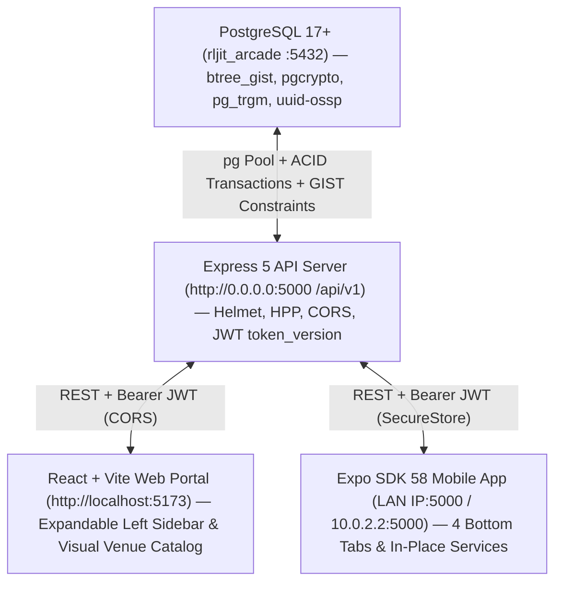
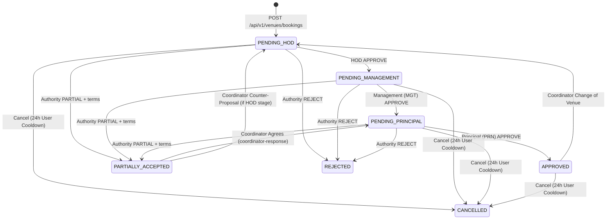

# RLJIT Arcade — Operational Runbook & Systems Guide

> **Platform:** RLJIT Arcade Institutional ERP & Academic Automation Ecosystem  
> **Stack:** PostgreSQL 17+ • Node.js + Express 5 • React 18 + Vite + Tailwind CSS • React Native + Expo SDK 58

---

## 1. Architecture Overview

RLJIT Arcade runs a unified relational API backbone serving both the **Web Portal** (`web-portal/`) and the **Mobile App** (`mobile-app/`) with zero mock data and cryptographic PII protection.



| Layer | Technology & Runtime | Bind / Address | Key Capabilities |
| :--- | :--- | :--- | :--- |
| **Database** | PostgreSQL 17+ (`pg` driver) | `localhost:5432` (`rljit_arcade`) | Auto-initializes extensions (`btree_gist`, `pgcrypto`, `pg_trgm`, `uuid-ossp`), atomic `id_sequences`, dual-table sync (`users` + `student`/`faculty`/`admin`), and normalized domain tables (`venues`, `venue_bookings`, `timetable_slots`, `attendance_records`, `cie_marks`, `placement_drives`, `placement_applications`, `finance_records`). |
| **Backend API** | Node.js ESM + Express 5 | `http://0.0.0.0:5000` (`/api/v1`) | Argon2id password hashing, AES-256-GCM PII encryption, HMAC-SHA256 blind indexes, live `token_version` JWT revocation, `pg_xmin`/`pg_ctid` `dbReceipt` proofs, and <50ms SQL analytics (`GET /api/v1/analytics/overview`). |
| **Web Portal** | React 18 + Vite + Tailwind CSS 3.4 | `http://localhost:5173` | Persistent dark left sidebar (`#141E2B`) with expandable sections (`Dashboard`, `Venues`, `Academics`, `Portals`, `Administration`, `My Profile`), Visual Venue Catalog (`09:00–17:00` slots), and `⌘K` user directory search. |
| **Mobile App** | React Native 0.88 + Expo SDK 58 | `exp://<LAN_IP>:8081` -> `http://<LAN_IP>:5000` | 4 bottom tabs (`Dashboard`, `Services`, `Directory`, `Profile`), in-place `ServicesScreen` tools (`← Back to Services`), `expo-secure-store`, `expo-local-authentication` biometrics, and `expo-screen-capture` protection. |

---

## 2. Startup Sequence

### Step 1: Verify PostgreSQL 17+ Service & Extensions
Ensure PostgreSQL is listening on port `5432` and `backend/.env` matches your database credentials (`PG_HOST`, `PG_PORT`, `PG_USER`, `PG_PASSWORD`, `PG_DB=rljit_arcade`):

```powershell
# Check PostgreSQL service status (Windows PowerShell)
Get-Service *postgres*

# Verify PostgreSQL accepts connections on port 5432
pg_isready -h localhost -p 5432 -U postgres
```

> **Automatic Schema Initialization:** The backend invokes `ensureDatabaseExists()` on startup (`backend/src/config/db.js`) to create `rljit_arcade` if absent and apply all extensions, tables, indexes, and GIST exclusion constraints. You can also trigger or verify initialization manually via `GET http://localhost:5000/db:rljit_arcade/connect`.

---

### Step 2: Start the Express 5 Backend (`:5000`)
```powershell
cd backend
npm run dev
```
* Launches `node --watch src/server.js` bound to `0.0.0.0:5000`.
* Verify server health in browser or curl: `GET http://localhost:5000/`.

---

### Step 3: Start the React Web Portal (`:5173`)
Open a second terminal:
```powershell
cd web-portal
npm run dev
```
* Launches Vite dev server at `http://localhost:5173`.
* Navigate to `http://localhost:5173/login`.

---

### Step 4: Start the Expo SDK 58 Mobile App
Open a third terminal:
```powershell
cd mobile-app
npx expo start
```
* Press **`a`** for Android Emulator (`http://10.0.2.2:5000`).
* Press **`i`** for iOS Simulator (`http://localhost:5000`).
* Scan the QR code with **Expo Go** on a physical smartphone on the same Wi-Fi LAN (`http://<PC_LAN_IP>:5000`).

---

## 3. RBAC Portal Map

### 3.1 Master & Section Authority Matrix

| Role / Tier | Identifier Pattern | `sectionCode` / `adminTier` | Web Portal Route | Core Operational Authority |
| :--- | :--- | :--- | :--- | :--- |
| **Super Admin** | `RLSUPER001` | `adminTier: SUPER_ADMIN` | `/portal/super-admin/mastermind-home` | One-time bootstrap (`x-bootstrap-key`), provision all section admins/HODs/faculty, global student provisioning, venue management, universal review override, DB Ledger & Diagnostics. |
| **Admission Admin** | `RLADM_ADM_001` | `REGULAR_ADMIN` / `ADM` | `/portal/admin/adm/home` | Global student provisioning across **all** departments (including Year-1 `ALLIED_SCIENCE`), Document Vault upload & verification, Timetable CRUD (`POST /api/v1/timetable`). |
| **Accounts / Finance** | `RLADM_ACC_001` | `REGULAR_ADMIN` / `ACC` | `/portal/admin/acc/home` | Create/inspect normalized `finance_records`, record row-locked fee/fine payments (`PATCH /api/v1/finance/records/:id/pay`), legacy ledger charge & payment reconciliation. |
| **Placement Cell** | `RLADM_PLC_001` | `REGULAR_ADMIN` / `PLC` | `/portal/admin/plc/home` | Create & manage `placement_drives` (`package_lpa`, `min_cgpa`, `eligible_branches`), monitor student applications, initiate venue bookings. |
| **Sports Section** | `RLADM_SPT_001` | `REGULAR_ADMIN` / `SPT` | `/portal/admin/spt/home` | Sports portal workspace, initiate campus venue bookings (e.g., Open Air Theatre / Auditorium). |
| **Management** | `RLADM_MGT_001` | `REGULAR_ADMIN` / `MGT` | `/portal/admin/mgt/home` | Create campus venues (`POST /api/v1/venues`), **Tier-2 Venue Booking Review** (`PENDING_MANAGEMENT -> PENDING_PRINCIPAL`), global finance/booking visibility. |
| **Principal** | `RLADM_PRN_001` | `REGULAR_ADMIN` / `PRN` (`subRoles: ['PRINCIPAL']`) | `/portal/admin/prn/home` | **Tier-3 Final Venue Approval** (`PENDING_PRINCIPAL -> APPROVED`), Tier-2 post-EOD unlock approval, global booking & finance visibility. |
| **Examination Section** | `RLADM_EXM_001` | `REGULAR_ADMIN` / `EXM` | `/portal/admin/exm/home` | Examination portal workspace, Timetable CRUD (`POST /api/v1/timetable`), cross-department attendance/CIE & clearance auditing. |

### 3.2 11 HOD Departments (`adminTier: HOD_ADMIN`, `RLHOD<YY><DEPT>001`)
Each department supports **exactly one active HOD** (`409 Conflict` if duplicated), routed to `/portal/hod-admin/<dept>/home` with strict department-scope enforcement:

| Code | Department Name | Primary Scope |
| :--- | :--- | :--- |
| **`AIML`** | Artificial Intelligence & Machine Learning | Sem 3–8 AIML students + `core_branch = 'AIML'` visibility |
| **`DS`** | Data Science | Sem 3–8 DS students + `core_branch = 'DS'` visibility |
| **`CYBER`** | Cyber Security | Sem 3–8 CYBER students + `core_branch = 'CYBER'` visibility |
| **`CSE`** | Computer Science & Engineering | Sem 3–8 CSE students + `core_branch = 'CSE'` visibility |
| **`ME`** | Mechanical Engineering | Sem 3–8 ME students + `core_branch = 'ME'` visibility |
| **`ECE`** | Electronics & Communication Engineering | Sem 3–8 ECE students + `core_branch = 'ECE'` visibility |
| **`ALLIED_SCIENCE`** | Allied Science (Year-1 Common Cycle) | All Year-1 (`semester` 1–2) students across core branches |
| **`MATH_SCI`** | Mathematical Sciences | Department faculty, timetables, & Tier-1 venue approvals |
| **`PHY_CHEM`** | Physics & Chemistry | Department faculty, timetables, & Tier-1 venue approvals |
| **`HUMANITIES`** | Humanities & Social Sciences | Department faculty, timetables, & Tier-1 venue approvals |
| **`RND_ACADEMICS`** | Research & Academics | Department faculty, timetables, & Tier-1 venue approvals |

### 3.3 Faculty & Student Routing (Including Allied Science Year-1 `core_branch`)
* **Faculty (`baseRole: FACULTY`, `RLFAC<YY><DEPT>001` -> `/portal/faculty/home`):**
  * Provisioned with `classification` (e.g., `Professor`, `Associate Professor`, `Assistant Professor`, `Lab Instructor`, `Visiting Faculty`), `designation`, and `cabinRoom`.
  * Performs manual attendance & CIE entry, class swaps, LG mentorship, leave approvals, and acts as mandatory Venue Coordinator for student bookings.
* **Regular Students (`entryType: REGULAR`, USN `1RL<YY><BRANCH>001+` -> `/portal/student/home`):**
  * Enrolled from Semester 1 (`academic_year: 1`) through Semester 8 (`academic_year: 4`).
* **Lateral Entry Students (`entryType: LATERAL`, USN `1RL<YY><BRANCH>401+` -> `/portal/student/home`):**
  * Direct diploma entry starting at Semester 3 (`academic_year: 2`) with `401+` USN sequence block.
* **Allied Science Year-1 `core_branch` Routing:**
  * Year-1 students are enrolled with `department: "ALLIED_SCIENCE"`, `academicYear: 1`, `semester: 1` (or `2`), and `coreBranch` set to their future engineering stream (`CSE`, `AIML`, `DS`, `CYBER`, `ECE`, `ME`).
  * **USN Generation (`username.util.js`):** Uses `coreBranch || department`, producing branch-aligned USNs (e.g., `1RL26CSE001`) even while in Year-1 `ALLIED_SCIENCE`.
  * **Cross-Department Academic & Placement Visibility:** `academic.controller.js` grants access to both the `ALLIED_SCIENCE` HOD/Faculty (when `semester <= 2`) and the student's target `core_branch` HOD/Faculty. `portals.controller.js` evaluates placement eligibility against `core_branch || department`.

---

## 4. End-to-End Module Guides

### 4.1 Visual Venue Catalog & 3-Tier Approval State Machine
1. **Catalog Discovery (`GET /api/v1/venues?date=YYYY-MM-DD`):**
   * Returns active venues with `code`, `category`, `building`, `floor`, `amenities`, `booked_slots[]`, and computed `availability_status` (`AVAILABLE`, `PARTIALLY_BOOKED`, or `OCCUPIED` when >= 360 minutes or `09:00–17:00` is covered).
   * The Web Portal maps `booked_slots` onto a visual `09:00–17:00` hourly slot timeline.
2. **Double-Booking Concurrency (`POST /api/v1/venues/bookings`):**
   * Accepts either simplified IST `(booking_date, start_time, end_time)` or ISO `(event_start_time, event_end_time)`.
   * PostgreSQL `btree_gist` exclusion constraint `prevent_venue_double_booking` automatically wraps every slot with a **±30-minute setup/cleanup buffer** (`buffered_time_range`) and rejects overlapping active requests with HTTP `409 Conflict`.
   * Students must specify an active Faculty `coordinator_id`; Faculty/Admins default to self.
3. **3-Tier Approval State Machine (`PATCH /api/v1/venues/bookings/:id/review`):**



4. **Handover & Cancellation Cooldown:**
   * Urgent transfer requests (`POST /api/v1/venues/bookings/:id/transfer-request`) go to the active coordinator; approving via `PATCH /api/v1/venues/transfer-requests/:transferId/respond` atomically reassigns initiator, coordinator, and event details.
   * Cancelling via `POST /api/v1/venues/bookings/:id/cancel` immediately frees the GIST slot for other users while activating a native 24-hour PostgreSQL cooldown on the cancelling user for that venue (`403 Forbidden` on re-attempt).

---

### 4.2 Timetable & Class Swaps
* **Setup / Update Slots (`POST /api/v1/timetable`):** Authorized for `HOD` (dept-scoped), `ADM`, `EXM`, and `SUPER_ADMIN`. Upserts slots (`day_of_week` 1–6, `period_no`, `start_time`, `end_time`, `subject_code`, `subject_name`, `faculty_id`, `room_no`) into `timetable_slots`.
* **Query Schedule (`GET /api/v1/timetable`):** Supports `?department=&semester=&section=&facultyId=&day=`.
* **Class Swap Workflow (`PATCH /api/v1/timetable/:id/swap`):**
  1. Assigned Faculty (or HOD/Super Admin) submits `{ "action": "REQUEST", "swapped_faculty_id": "<UUID>", "swap_date": "YYYY-MM-DD" }` -> sets `swap_status = 'PENDING'`.
  2. Target `swapped_faculty_id` (or HOD/Super Admin) responds with `{ "action": "APPROVED" }` or `{ "action": "REJECTED" }`.
* *(Legacy `timetables` + `daily-view` swap-overlay endpoints also remain operational.)*

---

### 4.3 Manual Attendance & CIE Marks
* **Attendance Roster & Entry:**
  1. Faculty fetches roster via `GET /api/v1/attendance/section?department=...&semester=...&section=...&subject_code=...&attendance_date=...&period_no=...`.
  2. Faculty submits bulk statuses (`PRESENT`, `ABSENT`, `LATE`) via `POST /api/v1/attendance/manual`.
  3. Students inspect subject-wise percentages via `GET /api/v1/attendance/student/me` (or `/:studentId`).
* **CIE Marks Entry & Calculation:**
  1. Faculty fetches roster via `GET /api/v1/cie/section`.
  2. Faculty upserts `cie1`, `cie2`, `cie3`, `assignment`, `max_marks` via `POST /api/v1/cie/manual`. PostgreSQL automatically computes `total_cie = LEAST(ROUND(((cie1 + cie2 + cie3) / 3.0) + assignment, 2), max_marks)`.
  3. Students view semester averages via `GET /api/v1/cie/student/me`.

---

### 4.4 Placements Eligibility
1. **Drive Creation (`POST /api/v1/placements/drives`):** `PLC` Admin or `SUPER_ADMIN` publishes `company_name`, `role_title`, `package_lpa`, `min_cgpa`, `eligible_branches`, `drive_date`, and `status` (`OPEN`).
2. **Live Eligibility Evaluation (`GET /api/v1/placements/drives`):** For logged-in students, the backend compares `student.cgpa >= min_cgpa` and checks whether `COALESCE(student.core_branch, student.department)` appears in `eligible_branches` (empty array = open to all), attaching `is_eligible`, `applied`, and `application_status`.
3. **Application (`POST /api/v1/placements/drives/:id/apply`):** Enforces `drive.status === 'OPEN'`, CGPA threshold, branch match, and uniqueness (`409 Conflict` on duplicate application).

---

### 4.5 Finance Ledger & 4-Pillar Examination Clearance
1. **Create Obligation (`POST /api/v1/finance/records`):** `ACC` Admin or `SUPER_ADMIN` creates fee/fine obligations (`student_id` or `usn`, `fee_type`, `amount_due`, `fine_amount`, `due_date`). Status auto-sets to `PENDING`, `PARTIAL`, or `PAID`.
2. **Transactional Payment (`PATCH /api/v1/finance/records/:id/pay`):** `ACC` Admin or `SUPER_ADMIN` reconciles `payment_amount` and optional `fine_payment` inside a `BEGIN ... SELECT ... FOR UPDATE ... COMMIT` transaction.
3. **Ledger View (`GET /api/v1/finance/records`):** Returns itemized records + `summary` (`total_due`, `total_paid`, `total_fine`, `outstanding_balance`) scoped by role (`STUDENT`: self; `HOD`: own dept; `ACC`/`MGT`/`PRN`/`SUPER_ADMIN`: global).
4. **4-Pillar Hall Ticket Clearance (`GET /api/v1/student/clearance-status/:usn`):** Evaluates Attendance >= 85%, CIE Avg >= 12/30 (40%), Financial Dues = 0, and Document Vault unverified docs = 0.

---

## 5. Credentials Export Directory Map

Wave 5 bulk provisioning exports generated institutional credential sheets into department-partitioned CSV files under `rljit_arcade/credentials/<DEPT>/`:

```text
rljit_arcade/
└── credentials/
    ├── AIML/            # AI & Machine Learning HOD, faculty, and student CSVs
    ├── DS/              # Data Science HOD, faculty, and student CSVs
    ├── CYBER/           # Cyber Security HOD, faculty, and student CSVs
    ├── CSE/             # Computer Science & Engg HOD, faculty, and student CSVs
    ├── ME/              # Mechanical Engineering HOD, faculty, and student CSVs
    ├── ECE/             # Electronics & Comm Engg HOD, faculty, and student CSVs
    ├── ALLIED_SCIENCE/  # Year-1 Common Cycle faculty, HOD, and Year-1 student CSVs (with coreBranch USNs)
    └── ADMIN_PORTALS/   # Super Admin + 7 Section Admins (ADM, ACC, PLC, SPT, MGT, PRN, EXM) + Basic Sci/Humanities/R&D HODs
```

> **Security Hygiene:** Keep generated CSV exports strictly local for administrative onboarding and testing. Never commit plaintext credential CSVs to public remotes.

---

## 6. Troubleshooting Guide

### 1. Loopback vs. LAN Connectivity & CORS
* **Symptom:** Web Portal works on `localhost:5173`, but physical devices or LAN browsers cannot reach `:5000` or encounter CORS errors.
* **Diagnosis & Fix:**
  * `backend/src/server.js` binds explicitly to `0.0.0.0:5000` (all interfaces).
  * `backend/src/middlewares/security.middleware.js` allows `localhost`, `127.0.0.1`, private LAN subnets (`192.168.x.x`, `10.x.x.x`, `172.16-31.x.x`), and `exp://` origins automatically.
  * Rate limiting (`generalApiLimiter`: 200 req/15 min; `authLimiter`: 25 req/15 min) skips loopback requests (`127.0.0.1`, `::1`, `::ffff:127.0.0.1`). Avoid rapid-fire automated auth testing from non-loopback LAN IPs within a 15-minute window.

### 2. Windows Firewall Blocking Port `5000`
* **Symptom:** Expo Go on a physical phone shows `Network Error: Cannot reach backend at http://192.168.x.x:5000`.
* **Fix:** Run PowerShell as **Administrator** and open TCP port `5000` for your local network:
  ```powershell
  New-NetFirewallRule -DisplayName "RLJIT Arcade Backend 5000" -Direction Inbound -LocalPort 5000 -Protocol TCP -Action Allow -Profile Private,Domain
  ```
  Verify your PC's Wi-Fi IPv4 address with `ipconfig` and confirm PC and smartphone are on the same subnet (and Wi-Fi AP client isolation is disabled).

### 3. Expo SDK 58 IP Override (`mobile-app/src/config/api.js`)
The mobile client resolves the backend URL in 3 priority layers:
1. **`mobile-app/.env` (`EXPO_PUBLIC_API_URL`):** Create `mobile-app/.env` from `.env.example` with `EXPO_PUBLIC_API_URL=http://<YOUR_LAN_IP>:5000`, then restart Metro (`npx expo start -c`).
2. **Metro `scriptURL` Auto-Detection:** Automatically extracts the host PC LAN IP from `NativeModules.SourceCode.scriptURL` when running via LAN mode.
3. **In-App Runtime Override (No Rebuild Required):** On the Mobile **Login Screen**, expand **"Backend Server URL"**, enter `http://<YOUR_LAN_IP>:5000`, and tap **Save** (persisted in `expo-secure-store`).

### 4. PostgreSQL GIST `23P01` Exclusion Conflicts
* **Symptom:** `POST /api/v1/venues/bookings` or `PATCH /change-venue` returns `409 Conflict` with `"Place already occupied... kindly look for another one."`
* **Cause:** PostgreSQL constraint `prevent_venue_double_booking` detects overlap on `buffered_time_range` (`[event_start_time - 30m, event_end_time + 30m)`) with an existing active booking (`PENDING_HOD`, `PENDING_MANAGEMENT`, `PENDING_PRINCIPAL`, `PARTIALLY_ACCEPTED`, or `APPROVED`).
* **Resolution:**
  * Leave at least a 60-minute gap between adjacent events (30-min post-event buffer + 30-min pre-event buffer), inspect the returned `current_booking.coordinator` contact details, or submit an urgent handover via `POST /api/v1/venues/bookings/:id/transfer-request`.
  * Cancelling or rejecting a booking immediately frees the slot from the GIST index, while enforcing a 24-hour user cooldown on the cancelling initiator/coordinator.

### 5. JWT `token_version` Session Revocation (`401 Session revoked`)
* **Symptom:** Authenticated requests immediately return `401 Unauthorized: Session revoked: Token has been invalidated. Please log in again.`
* **Cause:** `verifyJWT` (`backend/src/middlewares/auth.middleware.js`) validates `decoded.tokenVersion === users.token_version` against live PostgreSQL on every request. Calling `POST /api/v1/auth/logout` atomically increments `token_version`, invalidating all previously issued JWTs across all tabs and devices.
* **Resolution:** Sign in again (`POST /api/v1/auth/login`) to obtain a fresh JWT matching the incremented `token_version`. (Web Portal auto-redirects to `/login?revoked=true`; Mobile App auto-clears `SecureStore`). If status `403 Account is deactivated` is returned, verify `users.is_active = TRUE`.
